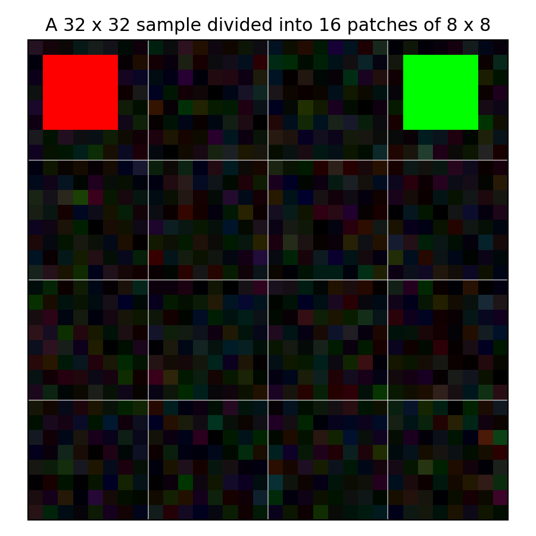
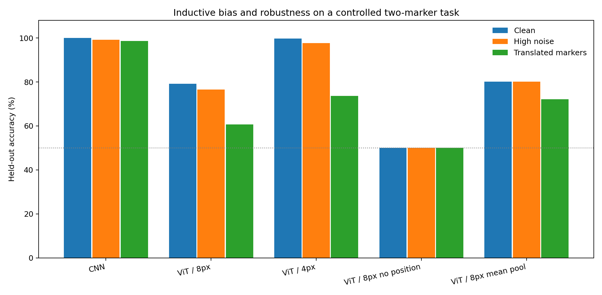
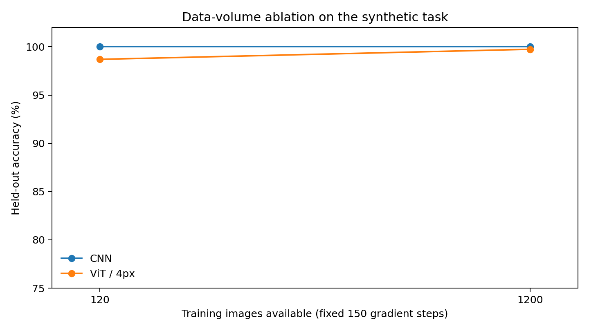

# Vision Transformer (ViT) From Scratch: Patches, Positions, and Inductive Bias

[](https://www.python.org/downloads/)
[](https://pytorch.org/)
[](LICENSE)
[](tests/test_lab.py)
[](#quick-start)

> **A minimal, mathematically transparent, and fully reproducible PyTorch implementation of the Vision Transformer (ViT) architecture, accompanied by a controlled empirical laboratory isolating spatial inductive bias, positional awareness, patch resolution, and translation equivariance against CNN baselines.**

---

## Visual Overview

<p align="center">
  
  <br />
  <em><b>Figure 1:</b> Image Tokenization. A 32×32 input image decomposed into a grid of 16 non-overlapping 8×8 patches before linear projection and positional addition.</em>
</p>

<p align="center">
  
  <br />
  <em><b>Figure 2:</b> Empirical Benchmark. Held-out accuracy across Clean, Gaussian Noise, and Coordinate Translation shifts for a spatial CNN vs. ViT variants (150 steps, 3 seeds).</em>
</p>

<p align="center">
  
  <br />
  <em><b>Figure 3:</b> Data-Volume Scaling Ablation. Sample efficiency of CNN vs. ViT (4px patches) when restricted to 120 vs. 1,200 training examples.</em>
</p>

---

## Table of Contents

- [Visual Overview](#visual-overview)
- [What This Project Does](#what-this-project-does)
- [What This Project Does NOT Claim To Do](#what-this-project-does-not-claim-to-do)
- [The Central Scientific Question](#the-central-scientific-question)
- [Architecture & Implementation](#architecture--implementation)
  - [1. Patch Projection ($x \to z_0$)](#1-patch-projection-x-to-z_0)
  - [2. Pre-LN Transformer Encoder](#2-pre-ln-transformer-encoder)
  - [3. 2D Bicubic Positional Interpolation](#3-2d-bicubic-positional-interpolation)
- [Empirical Benchmark Results](#empirical-benchmark-results)
  - [Measured Performance (3 Seeds, 150 Steps)](#measured-performance-3-seeds-150-steps)
  - [Key Takeaways](#key-takeaways)
- [Unit Tests & Invariant Verification](#unit-tests--invariant-verification)
- [Quick Start & Reproducibility](#quick-start--reproducibility)
  - [Installation](#installation)
  - [Run Tests](#run-tests)
  - [Run Benchmark](#run-benchmark)
  - [Run Data-Volume Ablation](#run-data-volume-ablation)
  - [Regenerate Figures](#regenerate-figures)
  - [Optional: CIFAR-10 Natural Images](#optional-cifar-10-natural-images)
- [Repository Structure](#repository-structure)
- [Copyright, Attribution, and Disclaimers](#copyright-attribution-and-disclaimers)
- [References](#references)

---

## What This Project Does

This laboratory provides an end-to-end, zero-dependency (PyTorch + NumPy + Matplotlib) educational implementation of the Vision Transformer introduced by [Dosovitskiy et al. (ICLR 2021)](https://arxiv.org/abs/2010.11929).

1. **Clean From-Scratch ViT Modules** (`vit_lab/model.py`):
   - **`PatchEmbedding`**: Converts raw image tensors $(B, C, H, W)$ into 1D token sequences $(B, N, D)$ via 2D convolution or linear projection over unfolded patches.
   - **`TransformerBlock`**: Multi-Head Self-Attention (MHSA) and MLP blocks configured with modern Pre-LayerNorm stabilization and residual pathways.
   - **`TinyViT`**: Complete classification architecture with prepended `[CLS]` token, learnable 1D/2D positional embeddings, classification head, and support for global mean pooling.
   - **Bicubic Position Interpolation**: Resamples learned position embedding grids to accommodate arbitrary input resolutions.
   - **`TinyCNN` Baseline**: A classic convolutional comparison model built with local receptive fields, spatial inductive bias, and translation equivariance.

2. **Controlled Synthetic Testbed** (`vit_lab/data.py`):
   - Formulates a deterministic relational reasoning problem: *"Is the red marker located to the left of the blue marker?"* ($y=1$ if $x_{\text{red}} < x_{\text{blue}}$, else $0$).
   - Marker vertical positions, background luminance, and local textures are randomized and class-balanced.
   - Offers three rigorous evaluation regimes:
     - **Clean Evaluation**: Standard held-out test distribution.
     - **Noisy Evaluation**: Corrupted with zero-mean additive Gaussian pixel noise.
     - **Coordinate-Shifted Evaluation**: Out-of-distribution spatial translation forcing models to reason over unfamiliar coordinate offsets.

3. **Mathematical Invariant Verification** (`tests/test_lab.py`):
   - 15 automated unit tests proving architectural invariants:
     - **Permutation Invariance**: ViT without positional embeddings produces identical outputs regardless of patch order.
     - **Projection Equivalence**: `nn.Conv2d` patch extraction is mathematically identical to `nn.Unfold` followed by `nn.Linear`.
     - **Interpolation Continuity**: Validates smooth grid resampling across dimension scaling.

---

## What This Project Does NOT Claim To Do

To ensure scientific honesty and set realistic expectations:

> [!IMPORTANT]
> **Non-Claims & Project Scope:**
>
> 1. **Not Google's Official Implementation**: This is an independent pedagogical laboratory created for study and analysis. It is **not** Google's codebase, is not affiliated with Google Research, and does not distribute Google's proprietary pretrained weights.
> 2. **No Claim of General Natural-Image Superiority**: Our synthetic benchmark uses controlled 32×32 synthetic relational images. **No claim is made that these numbers directly predict ImageNet-1k, ImageNet-21k, or JFT-300M performance.**
> 3. **Not a Reproduction of JFT-300M Scale**: As shown by Dosovitskiy et al., ViTs require massive pretraining datasets (14M–300M images) to overcome their lack of inductive bias. This project demonstrates precisely why ViT underperforms or destabilizes in small-data and spatial-shift regimes without pretraining.
> 4. **No Industrial Augmentation Pipeline**: Standard competitive ViT training recipes (DeiT, RandAugment, CutMix, Mixup, cosine schedules with linear warmup) are deliberately omitted from the synthetic core to isolate raw inductive biases.
> 5. **Not a Compute/FLOPs-Matched Race**: The models have different parameter counts (CNN: 166.5K, ViT-8: 48.2K, ViT-4: 51.3K) and run under a fixed 150-gradient-step regime rather than an exhaustive hyperparameter grid search.

---

## The Central Scientific Question

> *If an image classification decision depends purely on the spatial relative coordinates of two entities, how does a Vision Transformer compare to a Convolutional Neural Network? What happens when positional embeddings are removed, patch sizes shrink, or entity coordinates shift?*

Convolutional neural networks possess built-in **hard inductive biases**:
- **Translation Equivariance**: A feature detector fired at $(x, y)$ fires identically if shifted to $(x+\Delta x, y+\Delta y)$.
- **Locality**: Early layers only examine adjacent pixels within small receptive fields ($3 \times 3$ or $5 \times 5$).

Vision Transformers possess **soft inductive bias**:
- Self-attention is globally permutation-equivariant across patch tokens.
- **All spatial topology must be learned** through positional embeddings $\mathbf{E}_{pos}$. Without positional embeddings, a Vision Transformer treats an image as an unordered "bag of patches."

---

## Architecture & Implementation

### 1. Patch Projection ($x \to z_0$)

Given an input image $\mathbf{x} \in \mathbb{R}^{H \times W \times C}$ and patch resolution $P \times P$, the image is partitioned into $N = \frac{HW}{P^2}$ patches:

$$\mathbf{x}_p \in \mathbb{R}^{N \times (P^2 \cdot C)}$$

Each patch is linearly mapped to latent dimension $D$ using projection matrix $\mathbf{E} \in \mathbb{R}^{(P^2 C) \times D}$. A learnable `[CLS]` token $\mathbf{x}_{class} \in \mathbb{R}^{1 \times D}$ is prepended, and 1D learnable position embeddings $\mathbf{E}_{pos} \in \mathbb{R}^{(N+1) \times D}$ are added element-wise:

$$\mathbf{z}_0 = \left[ \mathbf{x}_{class}; \, \mathbf{x}_p^1 \mathbf{E}; \, \mathbf{x}_p^2 \mathbf{E}; \, \dots; \, \mathbf{x}_p^N \mathbf{E} \right] + \mathbf{E}_{pos}$$

```python
# vit_lab/model.py: Non-overlapping patch projection via Conv2d
self.proj = nn.Conv2d(
    in_channels=in_channels,
    out_channels=embed_dim,
    kernel_size=patch_size,
    stride=patch_size,
)
# (B, C, H, W) -> (B, D, H/P, W/P) -> (B, N, D)
tokens = self.proj(x).flatten(2).transpose(1, 2)
```

### 2. Pre-LN Transformer Encoder

Each of the $L$ encoder layers applies Pre-LayerNorm (Pre-LN) Multi-Head Self-Attention followed by a two-layer MLP with GeLU activations:

$$\mathbf{z}'_\ell = \text{MSA}(\text{LN}(\mathbf{z}_{\ell-1})) + \mathbf{z}_{\ell-1}$$

$$\mathbf{z}_\ell = \text{MLP}(\text{LN}(\mathbf{z}'_\ell)) + \mathbf{z}'_\ell$$

### 3. 2D Bicubic Positional Interpolation

When evaluating on resolutions different from training, 1D position embeddings are reshaped to a 2D grid $(1, \sqrt{N}, \sqrt{N}, D)$, bicubicly resampled, and restored:

```python
# vit_lab/model.py: Resampling learned positional embeddings
pos_tokens = interpolate_pos_encoding_2d(
    pos_embed=self.pos_embed[:, 1:],  # exclude [CLS]
    old_grid=(old_h, old_w),
    new_grid=(new_h, new_w),
)
```

---

## Empirical Benchmark Results

### Measured Performance (3 Seeds, 150 Steps)

The following metrics are derived directly from the three-seed reproducible benchmark (`results/benchmark.json`):

| Model Architecture | Patch Size | Parameters | Clean Test Accuracy | High-Noise Accuracy | Coordinate-Shifted Accuracy | Train Time (CPU) |
| :--- | :---: | :---: | :---: | :---: | :---: | :---: |
| **TinyCNN** | N/A (Conv) | 166,562 | **100.00%** $\pm$ 0.00% | **99.22%** $\pm$ 0.78% | **98.70%** $\pm$ 0.45% | ~2.2s |
| **TinyViT (4px)** | $4 \times 4$ ($N=64$) | 51,314 | **99.74%** $\pm$ 0.45% | **97.66%** $\pm$ 2.07% | 73.70% $\pm$ 11.73% | ~4.0s |
| **TinyViT (8px)** | $8 \times 8$ ($N=16$) | 48,242 | 79.17% $\pm$ 25.84% | 76.56% $\pm$ 23.22% | 60.68% $\pm$ 11.38% | ~1.8s |
| **TinyViT (8px, No Pos)** | $8 \times 8$ ($N=16$) | 47,154 | 50.00% $\pm$ 0.00% | 50.00% $\pm$ 0.00% | 50.00% $\pm$ 0.00% | ~1.5s |
| **TinyViT (8px, Mean Pool)** | $8 \times 8$ ($N=16$) | 48,242 | 80.21% $\pm$ 26.58% | 80.21% $\pm$ 26.17% | 72.14% $\pm$ 20.29% | ~1.6s |

### Key Takeaways

1. **Complete Permutation Failure Without Positions**:
   Removing positional embeddings (`vit8_no_pos`) collapses accuracy to **exactly 50.00%** (pure random guessing on binary classification). Because standard self-attention is set-permutation equivariant, the model cannot distinguish whether the red marker was to the left or right of the blue marker.
2. **Translation Equivariance Advantage**:
   The CNN achieves **98.70%** accuracy on translated/shifted markers due to convolutional weight sharing across spatial dimensions. In contrast, ViT-4 degrades to **73.70%** and ViT-8 to **60.68%** because positional indices must learn spatial associations from scratch.
3. **Patch Granularity Matters**:
   Moving from 8×8 patches ($N=16$) to 4×4 patches ($N=64$) increases spatial token resolution fourfold, boosting clean accuracy from **79.17%** to **99.74%** and reducing inter-seed variance.
4. **Data-Volume Sensitivity**:
   Under a low-data regime of only 120 samples (`results/low_data.json`), CNN retains **100.00%** clean accuracy, whereas ViT-4 achieves **98.70%** clean accuracy but drops to **61.20%** on shifted evaluations.

---

## Unit Tests & Invariant Verification

The repository includes a comprehensive 15-test suite in [`tests/test_lab.py`](tests/test_lab.py) executing in <1 second:

```bash
python -m unittest discover -s tests -v
```

```text
test_cnn (test_lab.VisionTransformerTests.test_cnn) ... ok
test_data_separate_seeds (test_lab.VisionTransformerTests.test_data_separate_seeds) ... ok
test_dataset_balance (test_lab.VisionTransformerTests.test_dataset_balance) ... ok
test_dataset_determinism (test_lab.VisionTransformerTests.test_dataset_determinism) ... ok
test_gradients_flow (test_lab.VisionTransformerTests.test_gradients_flow) ... ok
test_no_position_permutation_invariance (test_lab.VisionTransformerTests.test_no_position_permutation_invariance) ... ok
test_patch_projection_equals_unfold_plus_linear (test_lab.VisionTransformerTests.test_patch_projection_equals_unfold_plus_linear) ... ok
test_patch_shape (test_lab.VisionTransformerTests.test_patch_shape) ... ok
test_position_sensitive (test_lab.VisionTransformerTests.test_position_sensitive) ... ok
test_positional_interpolation (test_lab.VisionTransformerTests.test_positional_interpolation) ... ok
test_shift_has_same_balanced_labels (test_lab.VisionTransformerTests.test_shift_has_same_balanced_labels) ... ok
test_tiny_training_smoke (test_lab.VisionTransformerTests.test_tiny_training_smoke) ... ok
test_variant_factory (test_lab.VisionTransformerTests.test_variant_factory) ... ok
test_vit_forward (test_lab.VisionTransformerTests.test_vit_forward) ... ok
test_wrong_dimensions_rejected (test_lab.VisionTransformerTests.test_wrong_dimensions_rejected) ... ok
----------------------------------------------------------------------
Ran 15 tests in 0.714s

OK
```

---

## Quick Start & Reproducibility

### Installation

Requires Python 3.10+ and standard PyTorch:

```bash
git clone https://github.com/AdityaInamdar334/vit_patch_lab.git
cd vit_patch_lab
python -m pip install -r requirements.txt
```

### Run Tests

Verify all mathematical invariants and smoke tests:

```bash
python -m unittest discover -s tests -v
```

### Run Benchmark

Execute the multi-seed benchmark comparing all five configurations:

```bash
python -m vit_lab.benchmark \
  --seeds 3 \
  --steps 150 \
  --train-count 1200 \
  --eval-count 128 \
  --output results/benchmark.json
```

### Run Data-Volume Ablation

Evaluate sample efficiency under restricted dataset size:

```bash
python -m vit_lab.benchmark \
  --seeds 3 \
  --steps 150 \
  --train-count 120 \
  --eval-count 128 \
  --variants cnn vit4 \
  --output results/low_data.json
```

### Regenerate Figures

Regenerate all publication-quality figures directly from measured JSON results:

```bash
python plot_results.py
```

### Optional: CIFAR-10 Natural Images

To evaluate on real-world natural images with official train, validation, and held-out test splits:

```bash
# Train ViT-8 on CIFAR-10
python -m vit_lab.cifar_train \
  --model vit8 \
  --download \
  --epochs 5 \
  --max-train 5000 \
  --batch-size 128

# Train CNN baseline on CIFAR-10
python -m vit_lab.cifar_train \
  --model cnn \
  --epochs 5 \
  --max-train 5000 \
  --batch-size 128
```

---

## Repository Structure

```text
vit_patch_lab/
├── .gitignore                      # Git exclusion rules
├── LICENSE                         # MIT License file
├── README.md                       # Repository documentation & study guide
├── ARTICLE.md                      # Complete 7,800+ word technical tutorial
├── BENCHMARK_NOTES.md              # Experimental protocol & seed variances
├── requirements.txt                # Core dependencies (torch, numpy, matplotlib)
├── plot_results.py                 # Generates high-res PNG plots from JSON runs
├── figures/                        # High-resolution benchmark visual artifacts
│   ├── 01_clean_noise_translation.png
│   ├── 02_training_data.png
│   └── 03_patch_grid.png
├── results/                        # Measured JSON experimental benchmark outputs
│   ├── benchmark.json              # Primary 3-seed, 5-variant benchmark runs
│   └── low_data.json               # 120-sample low-data ablation
├── tests/                          # Rigorous unit and architectural invariant tests
│   └── test_lab.py                 # 15 tests covering shapes, math, invariance
└── vit_lab/                        # Core Python package implementation
    ├── __init__.py                 # Package exports
    ├── model.py                    # PatchEmbedding, TransformerBlock, TinyViT, TinyCNN
    ├── data.py                     # Deterministic spatial relational generator
    ├── train.py                    # Training loops, loss calculation, evaluation
    ├── benchmark.py                # Multi-seed evaluation CLI harness
    └── cifar_train.py              # Real CIFAR-10 training & validation pipeline
```

---

## Copyright, Attribution, and Disclaimers

### Author & Copyright

- **Author**: Aditya Inamdar ([@AdityaInamdar334](https://github.com/AdityaInamdar334))
- **Copyright**: © 2026 Educational ViT Lab Contributors.

### License

This repository's original code, benchmarks, documentation, and figures are licensed under the **MIT License**. See the full license text in [`LICENSE`](LICENSE).

### Third-Party Citations & Trademarks

- **Vision Transformer (ViT)** was introduced by Google Research and Brain Team in Dosovitskiy et al. (2020).
- **CIFAR-10** dataset is created and maintained by Alex Krizhevsky, Vinod Nair, and Geoffrey Hinton.
- All product names, trademarks, and registered trademarks mentioned herein (e.g., Google, PyTorch, CIFAR, ImageNet) belong to their respective holders. Their inclusion in this repository is purely for academic citation, identification, and pedagogical context, and does not imply any affiliation, sponsorship, or endorsement.
- No copyrighted pretrained model weights or closed-source commercial dataset archives are distributed inside this repository.

---

## References

1. **An Image is Worth 16x16 Words: Transformers for Image Recognition at Scale**  
   Alexey Dosovitskiy, Lucas Beyer, Alexander Kolesnikov, Dirk Weissenborn, Xiaohua Zhai, Thomas Unterthiner, Mostafa Dehghani, Matthias Minderer, Georg Heigold, Sylvain Gelly, Jakob Uszkoreit, Neil Houlsby.  
   *ICLR 2021*. [arXiv:2010.11929](https://arxiv.org/abs/2010.11929) | [Official Google Research Repository](https://github.com/google-research/vision_transformer)

2. **Training data-efficient image transformers & distillation through attention (DeiT)**  
   Hugo Touvron, Matthieu Cord, Matthijs Douze, Francisco Massa, Alexandre Sablayrolles, Hervé Jégou.  
   *ICML 2021*. [arXiv:2012.12877](https://arxiv.org/abs/2012.12877)

3. **How to train your ViT? Data, Augmentation, and Regularization in Vision Transformers**  
   Andreas Steiner, Alexander Kolesnikov, Xiaohua Zhai, Ross Wightman, Jakob Uszkoreit, Lucas Beyer.  
   *TMLR 2022*. [arXiv:2106.10270](https://arxiv.org/abs/2106.10270)

4. **Annotated Vision Transformer**  
   labml.ai Annotated Deep Learning Paper Implementations.  
   [https://nn.labml.ai/transformers/vit/index.html](https://nn.labml.ai/transformers/vit/index.html)
